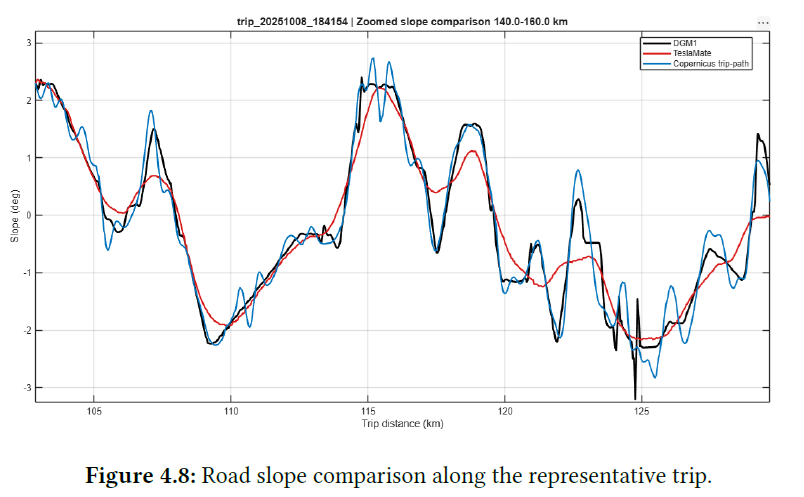
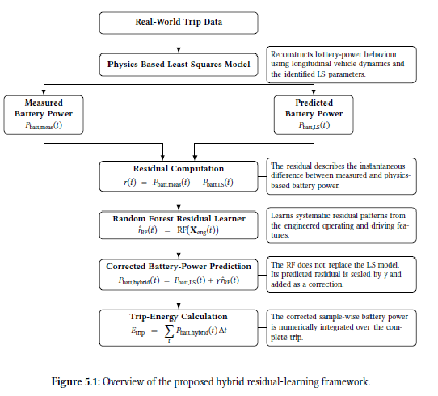
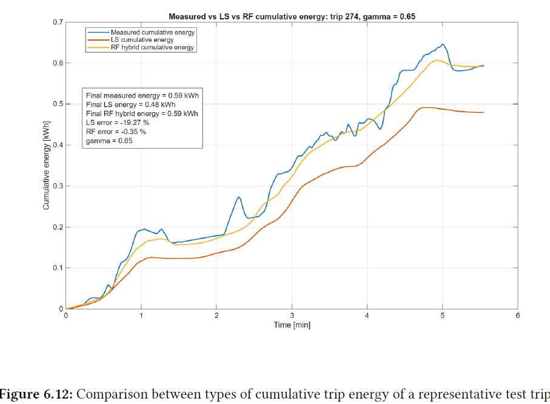

# Vehicle Load Modeling Based on Real-World Driving Profiles and Dynamics

**Hybrid Physics-Based and Machine Learning Framework for Battery-Electric Vehicle Energy Prediction**

[**View Project Portfolio (PDF)**](docs/Vehicle_Load_Modeling_Portfolio.pdf)

## Project Overview

Predicting the energy consumption of a battery-electric vehicle under real-world driving conditions is challenging because vehicle dynamics, road slope, environmental conditions, and powertrain losses interact throughout a trip.

This project investigates whether a hybrid modelling framework can improve battery energy prediction compared with a conventional physics-based model.

The approach combines longitudinal vehicle dynamics, least-squares parameter identification, and Random Forest residual learning. It was developed and evaluated using 404 recorded trips from a Tesla Model 3.

## Engineering Objectives

- Process real-world vehicle signals into consistent time-series data.
- Reconstruct road slope using digital elevation models.
- Develop a physics-based battery-power prediction model.
- Identify uncertain vehicle parameters using least-squares optimization.
- Train a Random Forest model to predict remaining battery-power errors.
- Evaluate the improvement in battery-power and trip-energy predictions.

## Methodology

### 1. Driving Data Preprocessing

Real-world driving data recorded through TeslaMate were processed in MATLAB. Vehicle signals included speed, battery power, state of charge, outside temperature, and geographic information.

The preprocessing workflow addressed sampling inconsistencies, signal noise, and missing observations, producing a consistent 1 Hz dataset.

### 2. Road-Slope Reconstruction

Road slope contributes directly to the gravitational force acting on a moving vehicle.

Three elevation sources were investigated: vehicle-derived TeslaMate elevation, Copernicus GLO-30, and high-resolution DGM1 terrain data.

DGM1 was selected for the final modelling framework because it produced more consistent elevation and road-slope estimates for the analysed driving routes.

### 3. Physics-Based Vehicle Dynamics

A longitudinal vehicle dynamics model was developed to estimate battery power from aerodynamic drag, rolling resistance, gravitational force, vehicle acceleration, and drivetrain losses.

Least-squares optimization was used to identify uncertain model parameters from measured vehicle data.

This provided an interpretable physics-based baseline for evaluating the hybrid approach.

### 4. Random Forest Residual Learning

The physics-based model could reproduce overall energy-demand trends but retained prediction errors under certain driving conditions.

A Random Forest regression model was trained using 25 engineered features to estimate the remaining battery-power residual.

The predicted residual was combined with the physics-based estimate using a correction factor selected through validation.

## Results

The final framework was evaluated using a 70/15/15 training, validation, and test split across 404 recorded trips.

| Evaluation metric | Physics-Based LS | Hybrid LS + RF |
|---|---:|---:|
| Test-set mean absolute trip-energy error | 12.59% | **7.86%** |
| Validation-set mean absolute trip-energy error | 12.68% | **8.35%** |
| All-trip mean absolute trip-energy error | 10.85% | **6.55%** |

On the independent test set, the hybrid model achieved a **37.6% relative reduction** in mean absolute trip-energy error compared with the least-squares baseline.

The hybrid model improved trip-energy predictions for **53 of 62 test trips (85.5%)**.

Improvements were particularly noticeable for shorter trips, where transient driving conditions and auxiliary loads can contribute substantially to prediction error.

## Engineering Findings

The investigation highlighted three important observations.

First, reliable road-slope reconstruction is important for estimating the gravitational component of vehicle energy demand.

Second, physics-based models provide an interpretable foundation, but uncertainties in real-world operating conditions can introduce substantial residual errors.

Third, machine-learning residual correction can improve energy predictions without entirely replacing the underlying vehicle dynamics model.

## Limitations

The framework was evaluated using recorded trips from a single Tesla Model 3. Its performance on other vehicles, operating environments, and driving conditions has not been experimentally established.

Some physical effects, including wind conditions, vehicle loading, tyre characteristics, and detailed auxiliary power consumption, were not directly measured.

The Random Forest model may also perform less reliably when encountering operating conditions that differ substantially from its training data.

## Tools and Methods

**Programming:** MATLAB

**Engineering:** Longitudinal Vehicle Dynamics, Battery Energy Modelling, Least-Squares Parameter Identification

**Machine Learning:** Random Forest Regression, Residual Learning, Feature Engineering, Hyperparameter Selection

**Geospatial Analysis:** DGM1, Copernicus GLO-30, QGIS, Road-Slope Reconstruction

## Documentation

The [project portfolio PDF](docs/Vehicle_Load_Modeling_Portfolio.pdf) provides a more detailed explanation of the engineering methodology, selected equations, technical figures, evaluation results, and limitations.

This repository is intended as a technical portfolio presentation. Original driving datasets, MATLAB source code, and implementation files are not publicly distributed.

## Author

**Sourish Shetty**  
M.Sc. Electromobility — Friedrich-Alexander-Universität Erlangen-Nürnberg

[GitHub Profile](https://github.com/SourishShetty)
